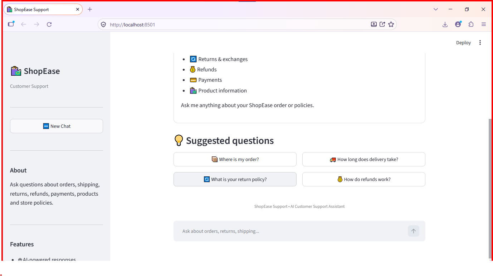
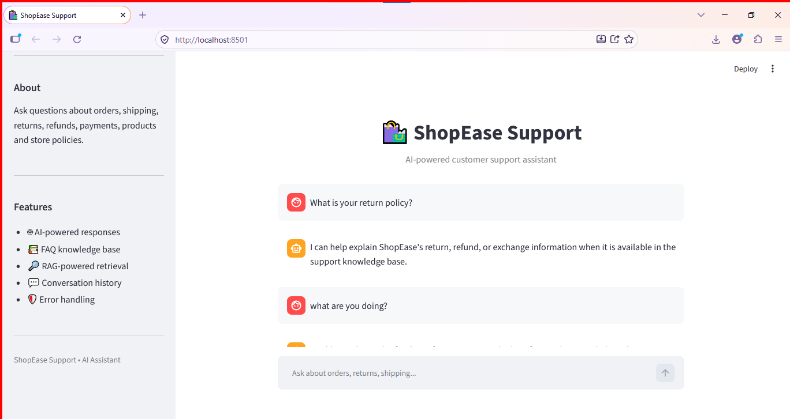
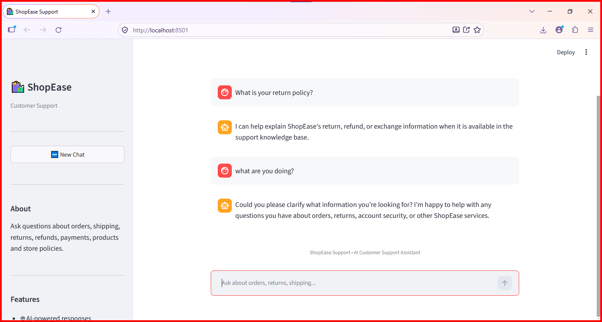
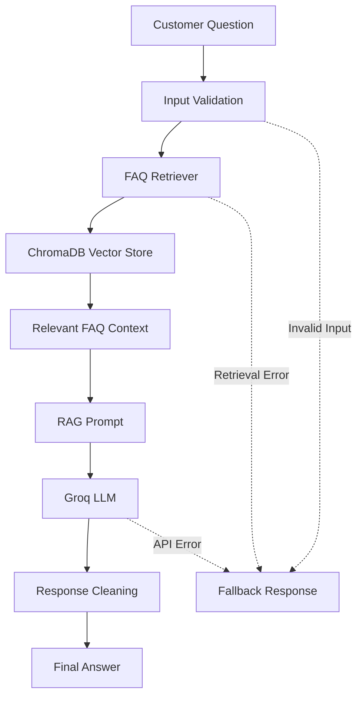

# 🛍️ ShopEase — E-commerce Customer Support Chatbot

An AI-powered e-commerce customer support chatbot built with **Python, Streamlit, LangChain, ChromaDB, Hugging Face embeddings, and Groq**.

ShopEase uses **Retrieval-Augmented Generation (RAG)** to retrieve relevant information from an FAQ knowledge base and generate context-aware customer support responses.

## 🌐 Live Demo

Try the deployed application:

**[Launch ShopEase Customer Support Chatbot](https://e-commerce-customer-support-faq-bot-4pnnkedbbfgxan7r8sglcs.streamlit.app/)**

## 📸 Screenshots

### 🏠 Chatbot Home Interface



### 🛡️ Error Handling



### 💬 Chatbot Response



## 📌 Overview

ShopEase is designed to automate common e-commerce customer support queries using a retrieval-based AI workflow.

The chatbot can assist with:

- Order-related questions
- Shipping and delivery
- Returns and refunds
- Payments
- Product information
- General store FAQs

The application retrieves relevant FAQ information before generating a response, helping keep answers grounded in the available knowledge base.

**Note:** Real-time order tracking, customer account access, and payment-system integration are not claimed unless separately implemented.

## ✨ Key Features

- 🤖 AI-powered customer support
- 🧠 Retrieval-Augmented Generation (RAG)
- 🔎 Semantic FAQ retrieval
- 🗄️ ChromaDB vector storage
- 🔤 Hugging Face sentence-transformer embeddings
- ⚡ Groq LLM integration
- 💬 Conversation history support
- 🛡️ Fallback responses for unsupported or failed requests
- 🚨 Centralized error handling
- 📝 Application logging
- 🎯 Suggested customer questions
- 🖥️ Interactive Streamlit interface
- 🧪 Automated testing with pytest

## 🛠️ Tech Stack

| Technology | Purpose |
|---|---|
| Python | Core application logic |
| Streamlit | Web interface |
| LangChain | LLM and RAG orchestration |
| ChromaDB | Vector database |
| Hugging Face | Text embeddings |
| Sentence Transformers | Semantic representation of FAQ content |
| Groq API | LLM inference |
| Pytest | Automated testing |
| Git and GitHub | Version control and source code hosting |

## 🔄 RAG Architecture



### Workflow

1. The customer submits a question.
2. The application validates the input.
3. The retriever searches for relevant FAQ information.
4. ChromaDB provides relevant stored documents.
5. The RAG prompt combines the retrieved context with the question.
6. The Groq LLM generates a response.
7. The application cleans the response and returns the answer.
8. Error handling and fallback mechanisms provide safe responses when needed.

## 📂 Project Structure

```text
E-commerce Customer Support FAQ Chatbot/
│
├── app.py
├── create_kb.py
├── listmodels.py
├── requirements.txt
├── pytest.ini
├── README.md
├── .gitignore
├── .env.example
│
├── screenshots/
│   ├── home.png
│   ├── chat.png
│   └── rag-response.png
│
├── Data/
│   ├── faq.json
│   └── products.json
│
├── prompts/
│   ├── fallback_prompt.txt
│   ├── rag_prompt.txt
│   └── system_prompt.txt
│
├── src/
│   ├── __init__.py
│   ├── chatbot/
│   │   ├── __init__.py
│   │   ├── chatbot.py
│   │   └── response_handler.py
│   ├── data/
│   │   ├── __init__.py
│   │   └── load_faq.py
│   ├── llm/
│   │   ├── __init__.py
│   │   └── llm.py
│   ├── rag/
│   │   ├── __init__.py
│   │   ├── rag_chain.py
│   │   ├── retriever.py
│   │   └── vectorstore.py
│   └── utils/
│       ├── __init__.py
│       ├── error_handler.py
│       ├── fallback.py
│       └── logger.py
│
└── tests/
    ├── __init__.py
    ├── test_api_failure.py
    ├── test_chatbot.py
    ├── test_error_handler.py
    ├── test_fallback.py
    ├── test_faq.py
    ├── test_groq.py
    ├── test_rag.py
    ├── test_retriever.py
    └── test_response_handler.py
```

> Update this tree to match the exact files and capitalization in your repository.

## 🚀 Installation and Setup

### Prerequisites

- Python installed on your system
- Git
- A Groq API key

### 1. Clone the Repository

```bash
git clone YOUR_GITHUB_REPOSITORY_URL
cd YOUR_PROJECT_FOLDER
```

Replace the placeholders with your actual repository URL and folder name.

### 2. Create a Virtual Environment

```bash
python -m venv venv
```

Activate it on Windows PowerShell:

```powershell
.\venv\Scripts\Activate.ps1
```

### 3. Install Dependencies

```bash
python -m pip install -r requirements.txt
```

### 4. Configure Environment Variables

Copy `.env.example` to `.env` in the project root.

On Windows PowerShell:

```powershell
Copy-Item .env.example .env
```

Add your own API key using the environment variable name expected by the application:

```env
GROQ_API_KEY=your_groq_api_key
```

**Security:** Never commit your real `.env` file, API keys, passwords, or other secrets to GitHub.

### 5. Build the Knowledge Base

```bash
python create_kb.py
```

Run this command if your local knowledge base needs to be created before launching the application.

### 6. Run the Application

```bash
streamlit run app.py
```

Open the local URL shown in your terminal.

## 🧪 Testing

Run the automated test suite from the project root:

```bash
pytest -v
```

To run a specific test module:

```bash
pytest -v tests/test_chatbot.py
```

Tests cover areas such as input validation, FAQ loading, retrieval, RAG formatting, fallback responses, and error handling.

> Report the number of passing tests only after confirming the current test suite completes successfully.

## 🔐 Security and Configuration

- Keep API keys in environment variables.
- Do not commit `.env` or other files containing secrets.
- Use `.env.example` to document the required configuration without exposing credentials.
- Avoid returning raw internal exceptions to end users.
- Never request passwords, OTPs, or full payment-card details in customer conversations.

## 🚧 Future Improvements

- Real-time order tracking integration
- Customer account integration
- Product search and recommendations
- Multilingual customer support
- Human-agent handoff
- Customer support analytics
- Production monitoring and authentication

## 🎯 Project Objectives

This project demonstrates practical experience with Python application development, LLM integration, RAG architecture, vector databases, semantic retrieval, prompt engineering, API integration, error handling, testing, and Streamlit development.

## 🔗 Repository

**[View Source Code on GitHub](https://github.com/Nirbhay1612/E-commerce-Customer-Support-FAQ-Bot)**

## 👨‍💻 Author

**Nirbhay Tembhurne**

- GitHub: [Your GitHub Profile](https://github.com/Nirbhay1612)
